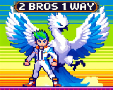
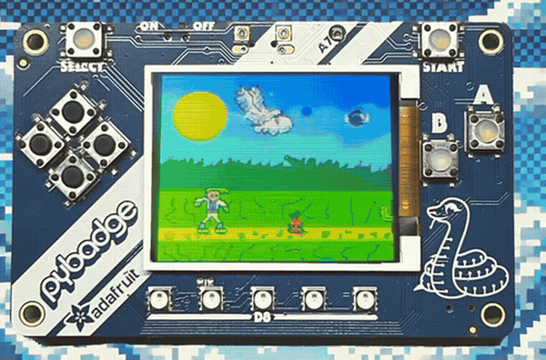

<div align="center">



# 2Bros1Way

**Ein Jump-'n'-Run, das nicht im Browser läuft, sondern auf einem Mikrocontroller — mit Framebuffer, Joystick und einer Lebensanzeige aus fünf LEDs.**

Uni-Projekt im Lab *Multimodal Media Madness* (M3), Lehr- und Forschungsgebiet Informatik 10 — Media Computing and Human-Computer Interaction, RWTH Aachen · Sommersemester 2024 · Gruppe 7

[](#stack)
[](#selbst-starten)
[](https://github.com/adafruit/Adafruit_Arcada)
[](https://hci.rwth-aachen.de/m3-2bros1way)

</div>

<br>

<!-- DEMO: Kommentarzeichen entfernen, sobald docs/media/2bros1way-demo.gif und
     -demo.mp4 existieren. Erzeugt werden sie mit:
     ~/Projekte/github-showcase/tools/make-demo.sh <aufnahme> --name 2bros1way
<div align="center">
  <a href="docs/media/2bros1way-demo.mp4">
    
  </a>
  <p><sub>Klick auf die Vorschau für das vollständige Demo-Video</sub></p>
</div>
-->

---

## Die Idee

Kilum und Arin sind unzertrennlich, bis der finstere Dämonenkönig sie verflucht:
Kilum verliert seine Kräfte, Arin wird in den Vogel Yalik verwandelt. Die beiden
ziehen los, um den Dämonenkönig zu finden und den Fluch zu brechen.

Daraus wird ein Jump-'n'-Run, in dem die zwei Figuren unterschiedliche Rollen
haben: Kilum läuft, springt und schlägt mit dem Schwert, Yalik fliegt und
schießt. Das Interessante daran ist nicht die Story, sondern wo das Spiel läuft.
Kein Browser, keine Engine, kein Betriebssystem — ein Mikrocontroller mit einem
kleinen TFT-Display, ein paar Kilobyte RAM und einem analogen Joystick an zwei
Pins. Jedes Sprite, jede Kollision und jeder Frame ist handgeschrieben.

---

## Was man damit machen kann

- 🎮 **Spielen** — zwei Level, jedes mit Endboss, dazu Cover, Menü, Win- und
  Game-Over-Screen.
- 🐦 **Den Vogel einsetzen** — Yalik schießt geradeaus und nach unten und nimmt
  selbst Schaden durch Feuer und Wasser.
- ⚔️ **Angreifen** — Schwertangriff mit eigener Animation und eigener
  Trefferprüfung.
- 💡 **Leben ablesen, ohne auf das Display zu schauen** — die fünf NeoPixel auf
  der Platine sind die Lebensanzeige.
- 🎵 **Musik hören** — ein WAV-Track wird gepuffert von der Karte gestreamt und
  am Ende automatisch neu gestartet.

---

## Wie es gebaut ist

Das Spiel läuft auf einem Board mit der
[Adafruit-Arcada-Bibliothek](https://github.com/adafruit/Adafruit_Arcada), die
Display, Dateisystem und WAV-Wiedergabe zusammenfasst. Gezeichnet wird nicht
direkt auf das Display, sondern in einen Framebuffer in der Größe des Panels —
sonst flackert jedes Bild sichtbar, während es aufgebaut wird.

Die Hauptschleife in [`2Bros1Way.ino`](2Bros1Way/2Bros1Way.ino) macht nur zwei
Dinge: sie hält den Musikpuffer gefüllt und schaltet zwischen drei Zuständen um
— Cover, Menü, Spiel. Alles andere liegt in Modulen, ein Header pro
Verantwortlichkeit:

| Modul | Aufgabe |
| :-- | :-- |
| `character.h` | Bewegung, Sprung, Schaden, Angriff der Spielfigur |
| `gameplay.h` | Spielschleife, Zustandsübergänge, Treffer- und Siegprüfung |
| `map.h` · `map_img.h` | Level-Aufbau und Hintergrund-Sprites |
| `enemy.h` · `boss.h` · `boos_img.h` | Gegner, Endbosse und ihre Grafiken |
| `item.h` · `obstacle.h` | Items, Hindernisse, Feuer und Wasser |
| `joystick.h` | analoger Joystick an `A0`/`A1`, Taster an Pin 5 |
| `music.h` | WAV-Streaming über Arcada |
| `globals.h` · `globals.cpp` | gemeinsamer Spielzustand |

Von den etwa 15.000 Codezeilen ist der größte Teil keine Logik, sondern
Bilddaten: die Sprites liegen als Arrays in den `*_img.h`-Dateien im
Programmspeicher, weil sie in den RAM nicht passen. Jedes davon wurde in
[Piskel](https://www.piskelapp.com/) selbst gezeichnet, zusammen mit einer
Maske pro Sprite für die transparenten Bereiche — die `.piskel`-Quelldateien
liegen in [`img/`](img/).

---

## Stack

| Bereich | Technologie |
| :-- | :-- |
| Sprache | C++ (Arduino) |
| Framework | Adafruit Arcada, Adafruit GFX, Adafruit NeoPixel |
| Grafik | Framebuffer in Panelgröße, Sprites als `PROGMEM`-Arrays |
| Eingabe | analoger Joystick (zwei Achsen, ein Taster) |
| Ausgabe | TFT-Display, 5 NeoPixel, WAV-Audio |
| Assets | Pixel-Art selbst gezeichnet in Piskel |

---

## Selbst starten

<!-- TODO: Boardnamen eintragen, mit dem das Projekt im Lab lief
     (Arcada unterstützt u. a. PyBadge, PyGamer, PyPortal, CLUE und HalloWing).
     Danach diesen Kommentar löschen. -->

```bash
git clone https://github.com/Larou123/2bros1way.git
cd 2bros1way
```

1. Arduino IDE öffnen und den Board-Support für das verwendete Arcada-Board
   installieren.
2. Über den Bibliotheksverwalter installieren: **Adafruit Arcada**,
   **Adafruit GFX**, **Adafruit NeoPixel**.
3. Die WAV-Datei aus [`music/`](music/) auf die Karte bzw. in den Flash-Speicher
   des Boards legen.
4. Den Joystick anschließen: X auf `A0`, Y auf `A1`, Taster auf Pin 5
   (mit `INPUT_PULLUP`, also gegen Masse schaltend).
5. [`2Bros1Way/2Bros1Way.ino`](2Bros1Way/2Bros1Way.ino) öffnen und hochladen.

Ohne angeschlossenen Joystick startet das Spiel, reagiert aber nicht auf
Eingaben — die Achsen liefern dann keinen auswertbaren Neutralwert.

---

## Was im Repo liegt

| Ordner | Inhalt |
| :-- | :-- |
| [`2Bros1Way/`](2Bros1Way/) | der Sketch und alle Module |
| [`img/`](img/) | Sprites als PNG plus die `.piskel`-Quelldateien |
| [`music/`](music/) | der WAV-Track |
| [`docs/media/`](docs/media/) | Demo-Video, GIF-Vorschau, Titelbild |
| `Protokoll.rtf` | Arbeitsprotokoll der Gruppe aus dem Semester |

---

## Gut zu wissen

- **Geplant waren fünf Level, ausgeliefert sind zwei** — jeweils mit Endboss.
  Der Umfang wurde im Semester bewusst gekürzt, um das Spiel fertig zu
  bekommen, statt fünf halbe Level zu haben.
- **Der Code ist Lab-Code.** Globaler Spielzustand in `globals.h`,
  Spiellogik in Headern statt in `.cpp`-Dateien, Dateinamen mit Tippfehlern
  (`boos_img.h`). Das ist so entstanden und ist absichtlich nicht
  nachträglich geglättet.
- **Die Bilddaten dominieren die Zeilenzahl.** Wer sich den Code ansieht,
  sollte bei `gameplay.h` und `character.h` anfangen, nicht bei den
  `*_img.h`-Dateien.
- **Die Musik startete lange nicht.** Siehe Commit-Verlauf — zwei Anläufe
  „musik implementiert, spielt aber nicht ab“, bevor das Puffern in der
  Hauptschleife saß.

---

## Gruppe

Entstanden in Gruppe 7 des M3-Labs an der RWTH Aachen im Sommersemester 2024.
Die offizielle Projektseite des Lehrgebiets:
[hci.rwth-aachen.de/m3-2bros1way](https://hci.rwth-aachen.de/m3-2bros1way).

Der Code lag ursprünglich im GitLab der RWTH und wurde für dieses Repo
übernommen.
